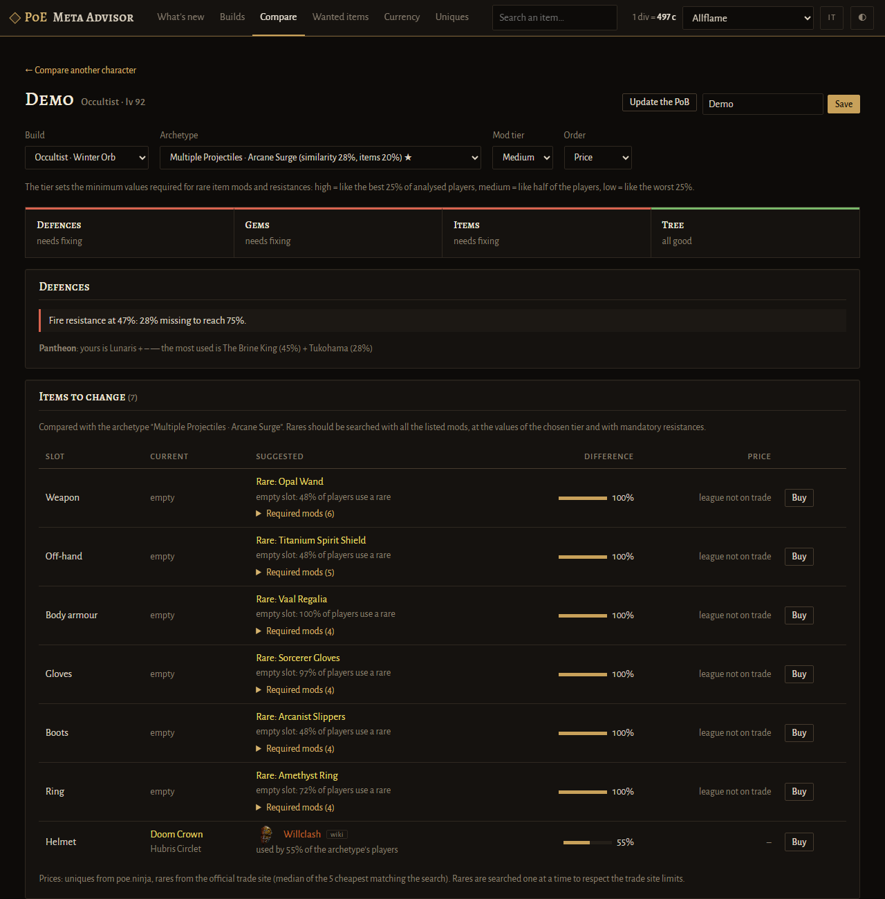
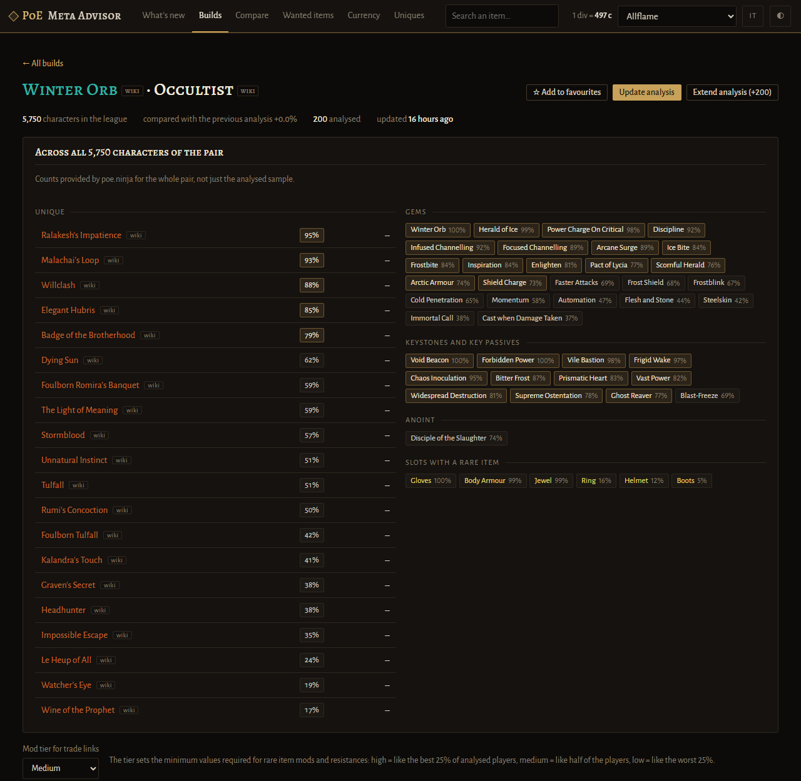
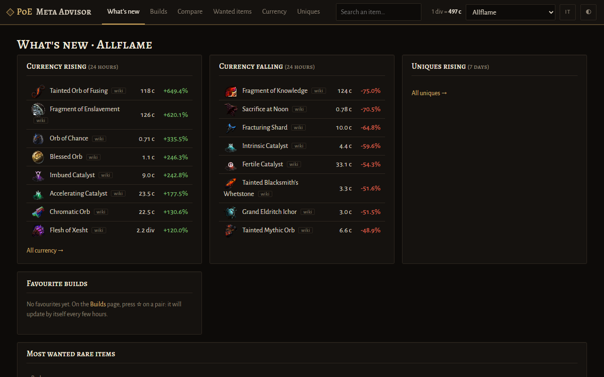

# PoE Meta Advisor

A small web app you run **on your own PC** that looks at what people are actually playing and buying in
**Path of Exile 1**, using public data from [poe.ninja](https://poe.ninja).

I made it because I kept doing the same thing by hand every league: open poe.ninja, filter a build,
open twenty characters, try to work out which rares they wear and what mods matter, then go to
the trade site and build the search. This does that part for you.

What it does, in short:

- **Builds**: pick a skill + ascendancy, it downloads a few hundred characters and groups them into
  archetypes (the actual variants people play), with the common gems, uniques, keystones and rare items.
- **Compare**: import your own character (PoB code or poe.ninja) and see what's different from the
  players of that build: which items to replace first, cheapest first, with a ready-made trade search
  for each one. Type a budget and it picks the set of upgrades that gets you closest to the build for
  that money. It also tells you if your resistances aren't capped.
- **Budget version**: for every archetype, the cheapest character that still plays it the normal way,
  and which expensive uniques it skips.
- **Trends**: uniques that more and more players of the analysed builds are using while the price hasn't
  moved yet (and the opposite: usage dropping, price still high).
- **Wanted items**: the rare item profiles (slot + base + mods) used by the most players, useful if you craft.
- **Currency / Uniques**: what's going up or down right now, with a local 30-day price history.

The interface is in English and Italian (switch with the button in the top bar).



| Build analysis | Market |
|---|---|
|  |  |

> Fan project, not affiliated with Grinding Gear Games or poe.ninja.

---

## Running it

You need **Java 21** (for example [Temurin](https://adoptium.net/)). You don't need Maven, the wrapper is included.

```bash
git clone https://github.com/AntoniazziDario96/projectPoe.git
cd projectPoe
```

Windows:

```bash
mvnw.cmd spring-boot:run
```

Linux / macOS:

```bash
./mvnw spring-boot:run
```

Then open **http://localhost:8080**.

The first start downloads the dependencies and takes a few minutes. After that it starts in a few seconds.
Everything it saves (analyses, price history, saved characters) goes into the `data/` folder next to the project.
To use another port, set the `PORT` environment variable (e.g. `PORT=9090`).

---

## Builds

1. The **Builds** page lists every skill + ascendancy pair in the league, with how many characters play it.
   The same skill on two ascendancies counts as two different builds.
2. Tick one or more pairs and press **Analyse**. For each pair it downloads **200 characters** in the
   background. This is slow on purpose: about **17 minutes per pair**, because poe.ninja blocks you
   if you go faster (see [poe.ninja limits](#poeninja-limits)). Analyses are queued, keep running if you
   close the page, and resume if you restart the app.
3. The characters are grouped into **archetypes**, groups of players running basically the same build
   (see [How archetypes work](#how-archetypes-work)). For each archetype you get:
   - share of the pair and estimated number of players in the league;
   - a **representative character** (the one most similar to everybody else in the group), with a link to
     poe.ninja and its **Path of Building code**;
   - support gems, uniques, keystones, masteries and bloodlines, split into **core** (≥ 70% of players)
     and optional;
   - **rare items per slot**: most common bases and mods. The mods in bold are the "profile" of the item
     (present on at least 40% of them, max 6). **Find similar items** opens the official trade site with
     those mods already filled in, at the values of the **tier** you chose (high / mid / low), and with
     resistances as a required total;
   - expensive gems to buy and an **estimated cost** for the build (core uniques and gems at current prices);
   - a **budget version**: among the typical characters of the archetype (leaving out the least similar
     quarter and anyone more than 5 levels under the average), the one whose uniques cost the least at
     today's prices, compared with what the typical character spends, and the common uniques it does without.
4. **Extend analysis** adds another 200 characters if you want better numbers.
5. Star a pair to make it a **favourite**: it gets refreshed by itself every 6 hours.

## Compare

Import your character and compare it with an analysed build.

1. Two ways to import:
   - **Path of Building**: paste the export code, or a **pobb.in**, **pastebin** or **poe.ninja/pob** link;
   - **poe.ninja**: account name (`Name#1234` works too) and character name. The character has to be
     public and listed on poe.ninja for the league selected in the top bar.
2. It picks the skill + ascendancy pair of your character and the **most similar archetype**. You can change both.
   Similarity is 70% items (slot by slot: how many players of the archetype use the same thing you use there),
   20% support gems and 10% keystones. Having extra stuff the archetype doesn't use doesn't lower it.
3. At the top there's a quick status for defences, gems, items and passive tree. Below that:
   - **defences**: uncapped elemental resistances (and by how much), chaos resistance, spell suppression,
     life or ES well below the archetype's average;
   - **items to change**, sorted by **price** (or by how different they are). Two kinds:
     uniques used by at least half of the players that you don't have, and rares that are too far from
     what the players use. For each rare you see the required mods with the minimum value and yours,
     and **Buy** opens the trade search;
   - missing **core support gems** and links that are too short;
   - **keystones** most players take and you don't;
   - the most used **pantheon**, when the analysis has it.
4. The **tier** sets the minimum values asked on rares: high = what the top 25% of players have,
   mid = the median, low = the bottom 25%. Resistances are always required (as a total, any combination).
   If you're missing resistances, the missing amount is split across the suggested rares and added to their
   searches, so after buying them you end up capped.
5. **Prices**: uniques come from poe.ninja, rares from the official trade site (median of the 5 cheapest
   listings for that exact search). Rare prices load one at a time to stay inside the trade site's rate limits.
   Event leagues that aren't on trade (e.g. Allflame) have no rare prices.
6. **Budget**: type how much you want to spend (div or chaos) and the rows that fit are highlighted.
   It doesn't just take the cheapest ones: every change has a value (how many players use that item and how far
   yours is from theirs, with a bonus for rares that also fix missing resistances) and it picks the combination
   with the most value that fits the budget. The plan updates as rare prices come in from the trade site.
7. Tick **Save** to keep the character and compare it again after a few upgrades (**Refresh from poe.ninja**
   or **Update the PoB**). It tells you how many suggested changes you had last time and how many you have now.

## Wanted items

The rare item profiles (slot + base + main mods) used by the archetypes of the pairs you analysed,
sorted by estimated number of players. Each one has a **Similar items** button that opens the trade site
with the search filled in (same base, rare, every profile mod, accepted as normal, crafted or fractured).
Mods the trade site has no filter for are marked as "not searchable".
It doesn't tell you how to craft them; that part is up to you.

## Trends

For every build you analysed at least twice, it compares how many players use each unique now and in the
previous analysis (using poe.ninja's numbers for the whole build, not just the sample), adds it up across builds,
and puts it next to the price change over the same period:

- **Buy**: usage up by at least 15%, price up by no more than 10%. More people need it, the market hasn't noticed yet.
- **Sell**: usage down by at least 15%, price not down by more than 10%.

The starting price comes from the price history saved on your PC; when that doesn't go back far enough it's
estimated from poe.ninja's 7-day change (marked with `*`). Only builds you analysed count, so the more builds you
favourite (they're re-analysed every 6 hours), the more useful this gets. It's a hint, not financial advice.

## Currency and uniques

- Currency and fragments **rising and falling** (24 hours or 7 days), uniques rising and falling, with trade links.
  Uniques can be filtered by type (weapons, armour, accessories, flasks, jewels).
- A **30-day price chart** stored locally (it fills up over time while the app is running).
- Items with very few trades or very low value are left out, so random noise doesn't show up as a "trend".
- **Unreliable prices** are left out too: if the traded volume (in chaos) is less than twice the price,
  basically one or two items changed hands and the price probably comes from a single trade.
  Real example: Fragment of Terror at 25 div with ~2,071 c of total volume.

## Other things

- Search bar in the top bar for any priced item, with price, changes and history.
- Every item, gem, base or skill has a small **wiki** link to the [PoE Wiki](https://www.poewiki.net).
- League picker (remembered), light / dark theme, Divine Orb price always visible.

---

## How archetypes work

For each character it looks at:

| What | Default weight |
|---|---|
| Support gems linked to the main skill | 35% |
| Passive tree nodes | 35% |
| Uniques, keystones, masteries and bloodlines | 30% |

The **similarity** between two characters is the weighted average of the Jaccard index of each group
(things in common divided by total things): 0 = nothing in common, 1 = identical.

Grouping is **hierarchical (average linkage)**: every character starts alone and the two most similar
groups get merged, again and again, until their average similarity drops under the threshold (0.55 by default).
Groups with fewer than 3 characters go into "Experimental variants". Archetypes under 5% of the pair are
marked as "minor variant" because there isn't much data behind them.

Each archetype is named after the two things that set it apart the most from the rest of the pair.

---

## Configuration

Everything is in [`src/main/resources/application.yml`](src/main/resources/application.yml), under `poemeta`:

| Key | Default | Meaning |
|---|---|---|
| `request-delay-ms` | 1000 | Pause between two requests to poe.ninja. **Don't go under 500.** |
| `builds.character-delay-ms` | 5000 | Pause between two character downloads (see [poe.ninja limits](#poeninja-limits)) |
| `default-league` | auto | Default league (`auto` = newest challenge league) |
| `builds.sample-size` | 200 | Characters per skill + ascendancy pair |
| `builds.extend-size` | 200 | Characters added by "Extend analysis" |
| `builds.min-characters` | 30 | Pairs with fewer characters are hidden |
| `builds.favorites-refresh-hours` | 6 | How often favourites are refreshed |
| `builds.character-cache-hours` | 24 | How long a downloaded character is reused |
| `archetypes.similarity-threshold` | 0.55 | Similarity needed to be in the same archetype (higher = more archetypes) |
| `archetypes.weight-*` | 0.35 / 0.35 / 0.30 | Weights for gems, tree, items |
| `archetypes.core-threshold` | 0.70 | Share above which something counts as "core" |
| `economy.refresh-minutes` | 30 | How often prices are refreshed |
| `economy.history-every-minutes` | 60 | How often a history point is saved |
| `economy.min-listings` | 10 | Minimum listings (or chaos volume for the Currency Exchange) to show up in the lists |
| `economy.min-chaos-currency` / `min-chaos-unique` | 0.5 / 10 | Minimum value to show up in the lists |

---

## Where the data comes from

poe.ninja has no documented public API, so the app calls the same endpoints the poe.ninja website uses.

| Data | Endpoint | Format |
|---|---|---|
| Leagues and snapshots | `/poe1/api/data/index-state`, `/poe1/api/data/build-index-state` | JSON |
| Currency and fragments | `/poe1/api/economy/exchange/current/overview` (recent leagues) or `/poe1/api/economy/stash/current/currency/overview` | JSON |
| Uniques and gems | `/poe1/api/economy/stash/current/item/overview` | JSON |
| Character search | `/poe1/api/builds/{version}/search` | protobuf (max 100 rows) |
| Search dictionaries | `/poe1/api/builds/dictionary/{hash}` | binary "NDIC" |
| Character details | `/poe1/api/builds/{version}/character` | JSON |
| Trade stat ids | `https://www.pathofexile.com/api/trade/data/stats` | JSON |
| Rare prices (Compare page) | `https://www.pathofexile.com/api/trade/search` and `/fetch` | JSON |
| Keystone and mastery names (PoB import) | `raw.githubusercontent.com/grindinggear/skilltree-export` (cached in `data/`) | JSON |

Notes:

- The search returns at most 100 characters, so to get 200 it merges several sort orders
  (level, life, DPS, energy shield, EHP).
- **These endpoints can change without notice.** If something stops working, the code to fix is in `it.poemeta.ninja`.
- Every request goes through one client with a minimum pause between calls (`RateLimitedHttp`), and characters
  already downloaded are reused. Please don't lower `request-delay-ms` too much; poe.ninja is run by one person.
- Rares have no price on poe.ninja, so the estimated build cost only includes uniques and gems.
  On the Compare page rare prices come from the official trade site, which has strict limits (go over them and
  you're locked out for up to 30 minutes). The app follows the limits the trade site sends back, caches prices for
  30 minutes, and shows "trade busy" instead of waiting too long.
- In the first days of a league (or in events) poe.ninja may not have unique and gem prices yet, so those
  sections stay empty.

## poe.ninja limits

Character details on poe.ninja are behind Cloudflare. Download around 60 characters in a couple of minutes
and your IP gets blocked for **an hour** (HTTP 429), including the poe.ninja character pages you open in your
browser from the same PC. That's why:

- there's a dedicated pause between character downloads (`builds.character-delay-ms`, 5 seconds by default),
  so 200 characters take about 17 minutes;
- if poe.ninja asks for a break anyway, the analysis stops, shows when it'll resume, and carries on by itself
  without losing what it already downloaded;
- downloaded characters are cached for 24 hours, so analysing the same pair again is much faster.

Search and prices don't have this problem.

---

## Project layout

```
src/main/java/it/poemeta
├── PoeMetaApplication.java      Spring Boot entry point
├── config/                      settings from application.yml, locale (IT/EN)
├── ninja/                       poe.ninja client (rate-limited HTTP, protobuf, dictionaries)
├── league/                      league list
├── economy/                     prices, changes, history
├── analysis/                    skill+ascendancy pairs, analyses, archetypes, wanted items
├── compare/                     PoB / poe.ninja import and comparison with archetypes
├── links/                       PoE Wiki and trade links, rare prices from the trade site
├── persistence/                 JPA entities and repositories (H2 file database)
└── web/                         controllers and view models
src/main/resources
├── application.yml
├── messages*.properties         Italian and English texts
├── templates/                   Thymeleaf pages
└── static/                      CSS and JavaScript
```

Java 21, Spring Boot 3.5, Thymeleaf, Spring Data JPA, H2. No frontend framework, just server-rendered pages
and a bit of plain JavaScript.

Tests:

```bash
./mvnw test
```

You can look at the database at http://localhost:8080/h2-console
(JDBC URL `jdbc:h2:file:./data/poemeta`, user `sa`, empty password).

---

## Ideas for later

- Progression order (gems and items by level range).
- Price alerts (desktop or Discord).
- Farming log with real profit per hour.
- Use GGG's official API as an alternative data source (needs an OAuth app registration).

Feedback and bug reports are welcome, open an issue on GitHub.
